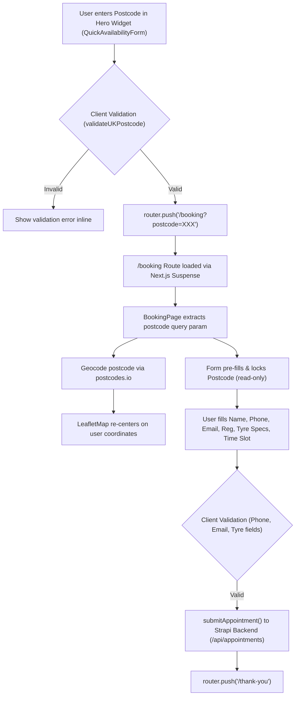

# Examination & Architecture: Postcode Availability & Booking Flow

> **File Reference:** Analysis of the "Find A Mobile Tyre Fitter Near You" widget ([QuickAvailabilityForm.jsx](file:///c:/Users/pc/Desktop/mtc-frontend/mobiletyre-frontend/src/components/QuickAvailabilityForm.jsx)) and the subsequent booking intake form page ([BookingPage.jsx](file:///c:/Users/pc/Desktop/mtc-frontend/mobiletyre-frontend/src/views/BookingPage.jsx)).

---

## 1. Overview of the UI in the Screenshot

The screenshot depicts the **Quick Availability Check Widget** prominently displayed in the Hero section of the homepage:

- **Heading:** "Find A Mobile Tyre Fitter Near You"
- **Input Field:** Postcode entry with a location pin icon (`MapPin`) and placeholder: `Enter postcode (e.g. GU11 or KT1)`.
- **Primary Call to Action (CTA):** High-contrast orange button (`#FB7E10`): `Check Availability Near You`.
- **Legal / Disclaimer Subtext:** `Subject to availability. Terms & Conditions apply*`.

---

## 2. Component Architecture & End-to-End Workflow



---

### Step 1: The Quick Availability Form (`QuickAvailabilityForm.jsx`)
* **Location:** Embedded in [Hero.jsx](file:///c:/Users/pc/Desktop/mtc-frontend/mobiletyre-frontend/src/components/Hero.jsx) as a high-conversion lead-capture entry point.
* **Component File:** [src/components/QuickAvailabilityForm.jsx](file:///c:/Users/pc/Desktop/mtc-frontend/mobiletyre-frontend/src/components/QuickAvailabilityForm.jsx)
* **Logic & Behavior:**
  1. **Input Handling:** Accepts partial (e.g. `GU11`, `KT1`) or full UK postcodes (e.g. `GU11 3HY`).
  2. **Validation:** Employs `validateUKPostcode(postcode)` from [appointmentService.js](file:///c:/Users/pc/Desktop/mtc-frontend/mobiletyre-frontend/src/api/appointmentService.js) using the regex:
     ```javascript
     /^[A-Z]{1,2}\d[A-Z\d]?(\s?\d[A-Z]{2})?$/i
     ```
  3. **Error Feedback:** Displays animated alert text: *"Please enter a valid postcode (e.g. GU11 or KT1 2AA)"* and highlights the input border in red if invalid or empty.
  4. **Redirection:** When validated, trims and uppercases the input, then executes:
     ```javascript
     router.push(`/booking?postcode=${encodeURIComponent(postcode.trim().toUpperCase())}`);
     ```

---

### Step 2: The Booking Page Route (`src/app/booking/page.js`)
* **Location:** [src/app/booking/page.js](file:///c:/Users/pc/Desktop/mtc-frontend/mobiletyre-frontend/src/app/booking/page.js)
* **Role:**
  - Configures SEO meta tags: `"Secure Online Booking | Mobile Tyre Champions"`.
  - Wraps the dynamic client component inside `<Suspense>` to handle query string hydration without SSR blocking.

---

### Step 3: Full Booking Form & Interactive Map (`BookingPage.jsx`)
* **Component File:** [src/views/BookingPage.jsx](file:///c:/Users/pc/Desktop/mtc-frontend/mobiletyre-frontend/src/views/BookingPage.jsx)
* **Functionality & Sections:**

#### A. Geocoding & Dynamic Map Centering
* Reads `postcode` parameter from `useSearchParams()`.
* Calls the open UK geocoding API:
  ```http
  GET https://api.postcodes.io/postcodes/{postcode}
  ```
* Retrieves `latitude` and `longitude`, updating the map center coordinates.
* Dynamically mounts [LeafletMap.jsx](file:///c:/Users/pc/Desktop/mtc-frontend/mobiletyre-frontend/src/components/LeafletMap.jsx) with SSR disabled (`next/dynamic`) showing a pin over the customer's coverage zone.

#### B. Customer Details & Locked Postcode
* **Full Name:** Required text input.
* **Phone Number:** Validated using `validateUKPhoneNumber` (requires valid UK format: 10–13 digits starting with `0` or `44`).
* **Email Address:** Checked against standard email regex pattern.
* **Vehicle Registration:** UK vehicle plate input (`vehicleReg`).
* **Postcode:** Pre-populated from the hero step and marked `readOnly` with a locked visual state (`cursor-not-allowed bg-gray-200`) to guarantee location continuity.
* **Address / Location Notes:** Multi-line textarea for exact street address, parking notes, or landmarks.

#### C. Tyre Specification Selectors
Customers select their exact tyre configuration using dropdown selectors:
* **Width:** `195`, `205`, `215`, `225`, `235`, `245`, `255`
* **Profile / Aspect Ratio:** `35`, `40`, `45`, `50`, `55`, `60`, `65`
* **Rim Diameter:** `15`, `16`, `17`, `18`, `19`, `20`, `21`
* **Speed Rating:** `H`, `V`, `W`, `Y`

#### D. Dispatch Timing Slots
Interactive selection chips for emergency or scheduled mobile fitting:
* `7am - 12pm`
* `12pm - 5pm`
* `5pm - 12am`

#### E. Call-to-Actions (Dual Conversion Path)
1. **Immediate Emergency Call:** Direct click-to-call link (`tel:02071013856`) labelled *"Call Now for Express Service"*.
2. **Form Submission Button:** *"Book An Appointment"* with loading indicator.

#### F. Submission & Strapi API Integration
* Bundles formatted tyre size: `${tyreWidth}/${profile} R${rim} ${speed}`.
* Generates a Google Maps link for the mobile fitting van driver:
  ```javascript
  https://www.google.com/maps/search/?api=1&query=${postcode} ${locationNotes}
  ```
* Dispatches data to Strapi backend via `submitAppointment()`:
  ```javascript
  POST https://enduring-morning-cf86e59201.strapiapp.com/api/appointments
  ```
* On success, immediately routes the customer to `/thank-you`.

---

## 3. Ready-To-Use Examination Prompt

Below is a complete, standardized prompt that can be used with any AI model, QA engineer, or code review assistant to inspect, audit, or test this functionality:

```markdown
### SYSTEM / AUDIT PROMPT: Examine Postcode Availability & Booking Flow

**Objective:**
Analyze and audit the end-to-end user journey from the "Find A Mobile Tyre Fitter Near You" widget on the homepage through to the complete appointment booking form.

**Context & Components to Examine:**
1. **Hero Widget:** `src/components/QuickAvailabilityForm.jsx` embedded in `src/components/Hero.jsx`.
2. **Navigation Flow:** Query parameter passing via Next.js App Router (`/booking?postcode={POSTCODE}`).
3. **Booking Intake Page:** `src/views/BookingPage.jsx` and wrapper `src/app/booking/page.js`.
4. **Services & Validation:** `src/api/appointmentService.js` and external geocoding via `https://api.postcodes.io`.
5. **Backend Submission:** Strapi REST API endpoint `/api/appointments`.

**Examination Criteria & Tasks:**
1. **Input Validation & Security:**
   - Verify regex rules for UK postcodes (both inward/outward partials like `GU11` and full codes like `GU11 3HY`).
   - Validate sanitization against XSS and injection in URL query parameters.
   - Review phone number validation (`validateUKPhoneNumber`) for UK domestic (`0...`) and international (`+44...`) formats.
2. **State Management & UX Continuity:**
   - How does the postcode persist from the Hero widget into the Booking page?
   - Is the postcode field appropriately locked (`readOnly`) to prevent mismatch with geocoding?
   - How are geocoding failures or slow responses from `postcodes.io` handled?
3. **Data Integrity & Payload Structure:**
   - Inspect the compiled appointment payload: customer info, concatenated tyre size format (`XXX/XX RXX X`), time slot, and auto-generated Google Maps dispatch link.
   - Confirm proper error boundary handling and loading states (`isGeocoding`, `loading`, spinner animations).
4. **Deliverables:**
   - List potential edge cases or failure modes (e.g. invalid postcodes, network drops, unlisted tyre sizes).
   - Provide recommended improvements for conversion rate optimization (CRO) and technical resilience.
```

---

## 4. Key Takeaways & Recommendations

| Area | Current Implementation | Enhancement Opportunities |
| :--- | :--- | :--- |
| **Postcode Verification** | Regex client-side check + Postcodes.io lookup on booking page | Validate service coverage radius directly in the Hero widget before redirecting. |
| **Address Input** | Manual textarea (`locationNotes`) | Integrate Google Places Autocomplete or Postcode Address Lookup API to auto-fill street addresses. |
| **Tyre Selection** | Manual dropdowns for Width / Profile / Rim / Speed | Allow vehicle registration lookup (DVLA API) to auto-detect tyre sizes. |
| **Error Handling** | Basic text alerts and fallback coordinates to Central London | Add retry mechanism for geocoding and display a fallback notice if outside active coverage area. |
